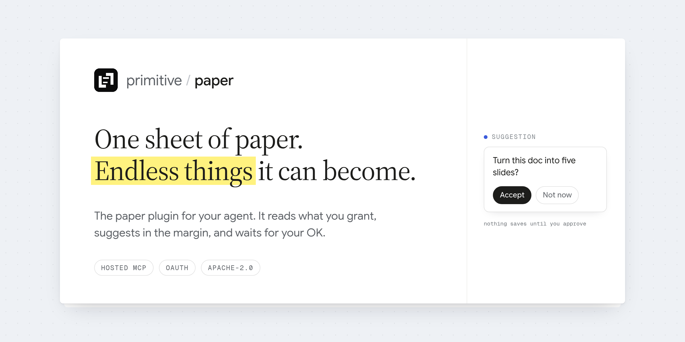

<p align="center">
  
</p>

<p align="center">
  <a href="#install"></a>
  <a href="https://primitivepaper.com"></a>
  <a href="#your-data"></a>
  <a href="#help"></a>
</p>

<p align="center">
  <a href="LICENSE"></a>
  <a href="https://registry.modelcontextprotocol.io/?q=au.com.primitiveai%2Fpaper"></a>
  <a href="#connect-with-mcp"></a>
</p>

**One sheet of paper. Endless things it can become.**

Start with a blank page and watch it turn into whatever you need: a doc, a budget, a slide deck, a canvas for messy ideas, a website you can publish, an RSVP form, or the floor plan for your dream house build. Make your homepage yours, then get to work.

And you're not working alone. paper is made for you and your agent to build things side by side. Everything's written in markdown, so you both see the same page. Your agent suggests ideas in the margin, nothing lands without your OK, and every change comes with a receipt you can undo.

Bring your own model. Sign in once. A highlighter like butter. Made by primitive ai, a boutique AI lab in Perth.

This plugin connects your agent to your paper, so it can find things, read them, and help out right on the page.

## How your agent behaves in paper

paper's agent asks first. That's the whole idea.

- **Reads only what you grant.** You choose what it can open, whether it can only read or also edit, and for how long. You can revoke it any time.
- **Suggests, never overwrites.** Edits arrive as suggestions in the margin, and nothing saves until you approve.
- **Checks before it writes.** If the page changed under it, it reads again instead of guessing.
- **Every change has a receipt.** Done means saved, and every receipt can be undone. Even an undo asks you first.

Bring your own model. paper doesn't lock you into one.

## What you can do

- Write and tidy docs, briefs and plans, in markdown.
- Build a sheet of numbers that adds itself up.
- Turn notes into slides, or a doc into a canvas, and back again.
- Put a one-page site together on a fine grid.
- Make a form that feels like paper, and read the answers (if you allow it).
- Sketch a floor plan for a house build, in millimetres, with every room's area worked out.
- Search across everything you've written.
- Bring in lots of document formats, and arrange your paper homepage the way you like it.

A few things to try once you're connected:

> What's in my paper this week?
>
> Find the opening plan and tell me what's left to do.
>
> Tidy up my notes doc. Keep my first line and make the rest warmer.
>
> Turn this doc into five slides.
>
> Make a feedback form for the cafe: the coffee, the food, and "back again?"

## Install

You'll need a paper account. Open one at [paper.primitiveai.com.au](https://paper.primitiveai.com.au).

### Install anywhere

paper is listed on the Official MCP Registry as **`au.com.primitiveai/paper`**. Listings for Cursor, Grok Build, Cline and Kimi are on the way. Until then, every client can connect with MCP.

| Your agent | How to connect |
| --- | --- |
| **Cursor** | Cursor Marketplace listing on the way. For now, [connect with MCP](#connect-with-mcp). |
| **Grok Build** | Plugin listing on the way. The manifest is in `.grok-plugin/`. |
| **Gemini CLI** | `gemini extensions install https://github.com/Primitivelabai/paper-plugin` |
| **Cline** | Add the [JSON below](#connect-with-mcp) to your MCP settings. |
| **VS Code / any MCP client** | Find `au.com.primitiveai/paper` in the [Official MCP Registry](https://registry.modelcontextprotocol.io/?q=au.com.primitiveai%2Fpaper), or [connect directly](#connect-with-mcp). |
| **Kimi** | Plugin listing on the way. The manifest is `kimi.plugin.json`. |

Gemini CLI opens your browser to sign in. If it doesn't, run `/mcp auth paper`.

### Cursor

Once the listing is up:

1. Install **primitive paper** from the Cursor Marketplace.
2. The first time your agent uses paper, Cursor opens a sign-in page. Sign in to paper and choose what this connection can see and do.
3. That's it. No keys to paste, nothing to store in the repo.

The MCP server is hosted at `https://paper.primitiveai.com.au/mcp` (streamable HTTP, OAuth with dynamic client registration). Permissions are `paper:read`, `paper:write` and `paper:responses` (form answers), and you choose which items each one covers when you connect.

### Connect with MCP

paper is a hosted remote MCP server, so any client that speaks streamable HTTP with OAuth can connect. Add it like this, then sign in when the browser opens:

```json
{
  "mcpServers": {
    "primitive-paper": {
      "type": "streamableHttp",
      "url": "https://paper.primitiveai.com.au/mcp"
    }
  }
}
```

Agents can follow [llms-install.md](llms-install.md) for step-by-step setup.

## What's in this plugin

| Part | What it does |
| --- | --- |
| `mcp.json` / `.mcp.json` | Connect to paper's hosted MCP server. |
| `.cursor-plugin/` / `.grok-plugin/` | Plugin manifests for Cursor and Grok Build. |
| `gemini-extension.json` / `GEMINI.md` | Gemini CLI extension and agent context. |
| `kimi.plugin.json` / `locales/` | Kimi plugin manifest and Chinese locale. |
| `server.json` | Official MCP Registry metadata. |
| `skills/getting-started` | What paper is, what it can do, and good first things to ask. |
| `skills/work-together` | How to change things in paper the paper way: read first, suggest, wait for your OK, keep the receipt. |
| `assets/` | The paper logo, icons, listing cover and custom README artwork. |

## Your data

Your account and papers are stored by the hosted paper service. Outside mail, calendar connections and your own AI keys stay on your device. Read the details in the [privacy policy](https://paper.primitiveai.com.au/privacy) and the [terms](https://paper.primitiveai.com.au/terms).

## Help

- Support: [paper.primitiveai.com.au/support](https://paper.primitiveai.com.au/support)
- Contact: [paper.primitiveai.com.au/contact](https://paper.primitiveai.com.au/contact)
- Website: [primitivepaper.com](https://primitivepaper.com)
- Email: [hello@primitiveai.com.au](mailto:hello@primitiveai.com.au)

## Licence

The plugin files in this repository are licensed under [Apache 2.0](LICENSE). paper itself is a hosted service covered by its [terms](https://paper.primitiveai.com.au/terms).

---

<p align="center">
  <br>
  Made by <a href="https://primitiveai.com.au">primitive ai</a> in Perth.<br>
  For people who love what tech brings and still keep a notepad.
</p>
